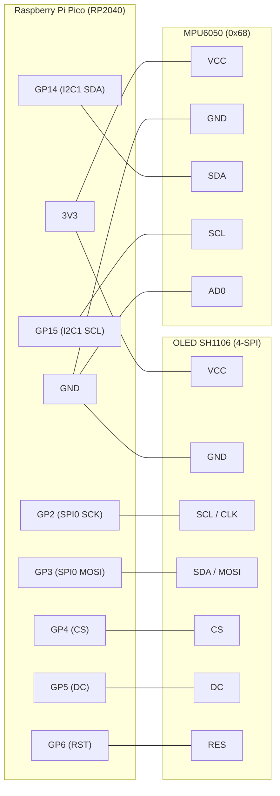

# Digital Level with RP2040 + MPU6050

[🇧🇷 Português](README.pt-BR.md) | 🇬🇧 English

A digital level (inclinometer) built with a Raspberry Pi Pico (RP2040), an MPU6050 accelerometer (or clone) and a 1.3" SH1106 OLED. The display shows a circular gauge with a needle and the angle in degrees, plus an "OK" indicator when the board is level.

> **Photo / video:** _(put the image or video link of the working project here)_

## Parts

- Raspberry Pi Pico (RP2040)
- MPU6050 module (or clone)
- 1.3" SH1106 128x64 OLED, 4-wire SPI
- Breadboard and jumper wires

## Circuit



## Pinout

| Peripheral | Signal | Pico pin |
|---|---|---|
| OLED (SPI0) | SCK / SCL | GP2 |
| OLED (SPI0) | MOSI / SDA | GP3 |
| OLED (SPI0) | CS | GP4 |
| OLED (SPI0) | DC | GP5 |
| OLED (SPI0) | RST | GP6 |
| MPU6050 (I2C1 / `Wire1`) | SDA | GP14 |
| MPU6050 (I2C1 / `Wire1`) | SCL | GP15 |

MPU I2C address: `0x68`. Power the MPU and the OLED from 3V3.

## Project structure

| File | Purpose |
|---|---|
| `src/config.h` | pins, axes, calibration and filter constants |
| `src/mpu.h/.cpp` | init, accelerometer reading, angle, calibration and adaptive filter |
| `src/display.h/.cpp` | OLED init and gauge drawing |
| `src/main.cpp` | just `setup()` and `loop()` |

## Build and upload

Requires [PlatformIO](https://platformio.org/).

```bash
pio run              # build
pio run -t upload    # flash the board
pio device monitor   # serial at 115200
```

The first time, hold the Pico's **BOOTSEL** button while plugging in the USB cable, then release it; after that, uploads work directly.

## Automatic calibration

At power-up, keep the board **lying flat and still** for about 2 s. The display shows "Calibrando..." meanwhile. The average of the readings becomes the zero. For manual fine tuning, change `ANGLE_TRIM` in `src/config.h`.

If the angle is on the wrong axis or has the wrong sign, adjust `VERT_AXIS`, `VERT_SIGN`, `TILT_AXIS` and `TILT_SIGN` in `src/config.h`.

## Adaptive filter

An exponential filter with a fixed gain forces a trade-off between fast response (jittery number) and a stable number (slow response). Here the gain `alpha` depends on the error between the new reading and the filtered value:

| Error | alpha | Effect |
|---|---|---|
| > 2.0° | `ALPHA_FAST` (0.60) | follows motion almost instantly |
| > 0.7° | `ALPHA_MID` (0.30) | intermediate tracking |
| small | `ALPHA_SLOW` (0.06) | smooths out noise |

There is also a **dead band** (`DEADBAND`, 0.15°): while the board is still, the displayed number only changes if the filtered value moves further than that; when you move the board it tracks normally again.

## Problems I solved

- **Library rejecting the MPU clone:** the Adafruit MPU6050 library fails to initialize because the clone's `WHO_AM_I` differs from the original. I replaced it with direct register reads over `Wire1`, which works fine.
- **Number overflowing the screen:** the signed value with a decimal did not fit in a large font. I used text size 2 and placed the number to the right of the gauge.
- **Slow filter:** a low fixed gain made the number lag behind motion. The adaptive filter uses a high gain when the error is large.
- **Noise:** with the board still, the last digit kept flickering. Fixed with an average of a few readings, the MPU's digital filter (~44 Hz), a low gain for small errors and the dead band.

## Note

On this core (earlephilhower), `printf` with `float` prints nothing over serial; use `Serial.print(value, decimals)`.
