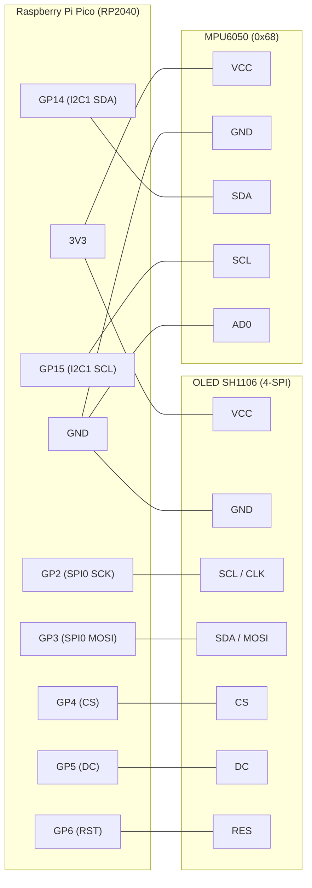

# Nível digital com RP2040 + MPU6050

🇧🇷 Português | [🇬🇧 English](README.md)

Nível digital (inclinômetro) feito com Raspberry Pi Pico (RP2040), um acelerômetro MPU6050 (ou clone) e um display OLED 1,3" SH1106. O display mostra um mostrador circular com ponteiro e o ângulo em graus, com uma indicação "OK" quando a placa está nivelada.

> **Foto / vídeo:** _(coloque aqui a imagem ou o link do vídeo do projeto funcionando)_

## Peças

- Raspberry Pi Pico (RP2040)
- Módulo MPU6050 
- Display OLED 1,3" SH1106 128x64, interface 4-SPI
- Protoboard e jumpers

## Circuito



## Pinagem

| Periférico | Sinal | Pino do Pico |
|---|---|---|
| OLED (SPI0) | SCK / SCL | GP2 |
| OLED (SPI0) | MOSI / SDA | GP3 |
| OLED (SPI0) | CS | GP4 |
| OLED (SPI0) | DC | GP5 |
| OLED (SPI0) | RST | GP6 |
| MPU6050 (I2C1 / `Wire1`) | SDA | GP14 |
| MPU6050 (I2C1 / `Wire1`) | SCL | GP15 |

Endereço I2C do MPU: `0x68`. Alimente o MPU e o OLED em 3V3.

## Estrutura

| Arquivo | Função |
|---|---|
| `src/config.h` | pinos, eixos, calibração e constantes do filtro |
| `src/mpu.h/.cpp` | init, leitura do acelerômetro, ângulo, calibração e filtro adaptativo |
| `src/display.h/.cpp` | init do OLED e desenho do mostrador |
| `src/main.cpp` | apenas `setup()` e `loop()` |

## Como compilar e gravar

Requer o [PlatformIO](https://platformio.org/).

```bash
pio run              # compila
pio run -t upload    # grava na placa
pio device monitor   # serial a 115200
```

Na primeira gravação, segure o botão **BOOTSEL** do Pico enquanto conecta o USB e solte em seguida; depois disso o upload funciona direto.

## Calibração automática

Ao ligar, deixe a placa **deitada e parada** por cerca de 2 s. Enquanto isso o display mostra "Calibrando...". A média das leituras vira o zero. Para um ajuste fino manual, altere `ANGLE_TRIM` em `src/config.h`.

Se o ângulo sair no eixo errado ou com sinal invertido, ajuste `VERT_AXIS`, `VERT_SIGN`, `TILT_AXIS` e `TILT_SIGN` em `src/config.h`.

## Filtro adaptativo

Um filtro exponencial com ganho fixo obriga a escolher entre resposta rápida (número tremendo) e número estável (resposta lenta). Aqui o ganho `alpha` depende do erro entre a leitura nova e o valor filtrado:

| Erro | alpha | Efeito |
|---|---|---|
| > 2,0° | `ALPHA_FAST` (0,60) | segue o movimento quase de imediato |
| > 0,7° | `ALPHA_MID` (0,30) | acompanhamento intermediário |
| pequeno | `ALPHA_SLOW` (0,06) | suaviza o ruído |

Além disso há uma **zona morta** (`DEADBAND`, 0,15°): com a placa parada o número exibido só muda se o valor filtrado se afastar mais que isso, e ao mover ele volta a seguir normalmente.

## Problemas que resolvi

- **Biblioteca recusando o clone do MPU:** a Adafruit MPU6050 falha na inicialização porque o `WHO_AM_I` do clone é diferente. Troquei por leitura direta dos registradores via `Wire1`, que funciona normalmente.
- **Número estourando a tela:** o valor com sinal e decimal não cabia em fonte grande. Usei fonte tamanho 2 e posicionei o número à direita do mostrador.
- **Filtro lento:** com ganho baixo fixo o número demorava a acompanhar o movimento. O filtro adaptativo usa ganho alto quando o erro é grande.
- **Ruído:** com a placa parada o último dígito oscilava. Resolvi com média de poucas leituras, filtro digital do MPU (~44 Hz), ganho baixo para erros pequenos e a zona morta.

## Observação

Neste core (earlephilhower) `printf` com `float` não imprime na serial; use `Serial.print(valor, casas)`.
